<div align="center">

<h1>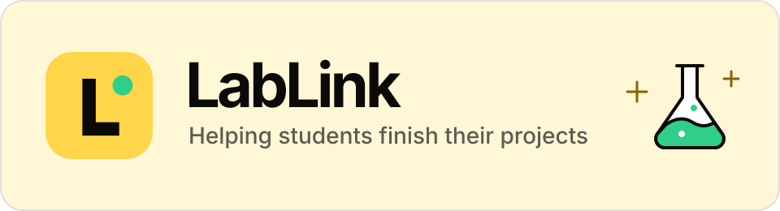</h1>

**A campus lab assistant that helps students finish projects on time.**

Describe a project, get a cross-department lab plan, and book the steps in order. If an instrument breaks, LabLink proposes a recovery plan around the work you can keep.

**[Open the deployed app](https://lablink-campus.vercel.app/)** · **[Try the live demo](https://lablink-campus.vercel.app/demo)** · **[Architecture](#7-architecture)** · **[Benchmark](#10-measured-results)**

Pick a demo ID card and tap in. No account setup required.

</div>

---

## 1. Screenshots

[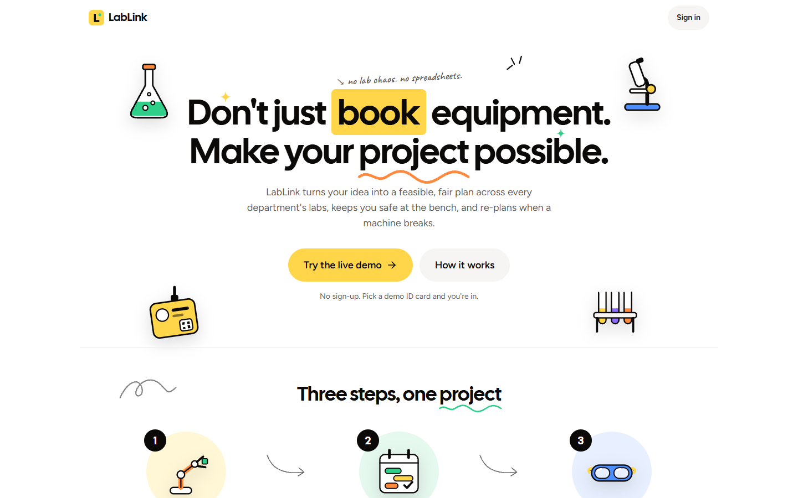](https://lablink-campus.vercel.app/)

| Demo sign-in | Feasibility Passport |
|---|---|
| [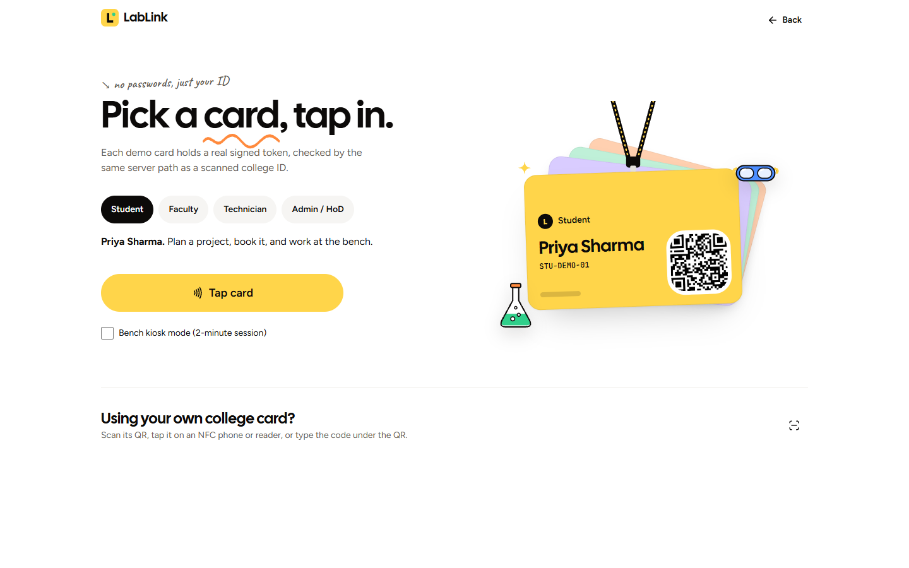](docs/screenshots/demo-cards.png) | [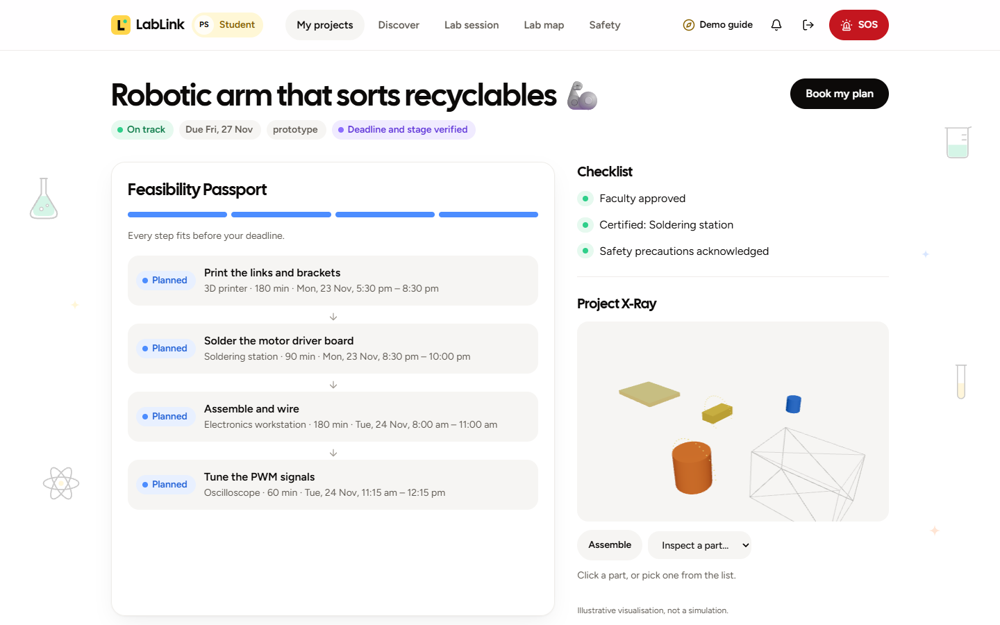](docs/screenshots/passport.png) |

| Finals Week decision | Lab analytics |
|---|---|
| [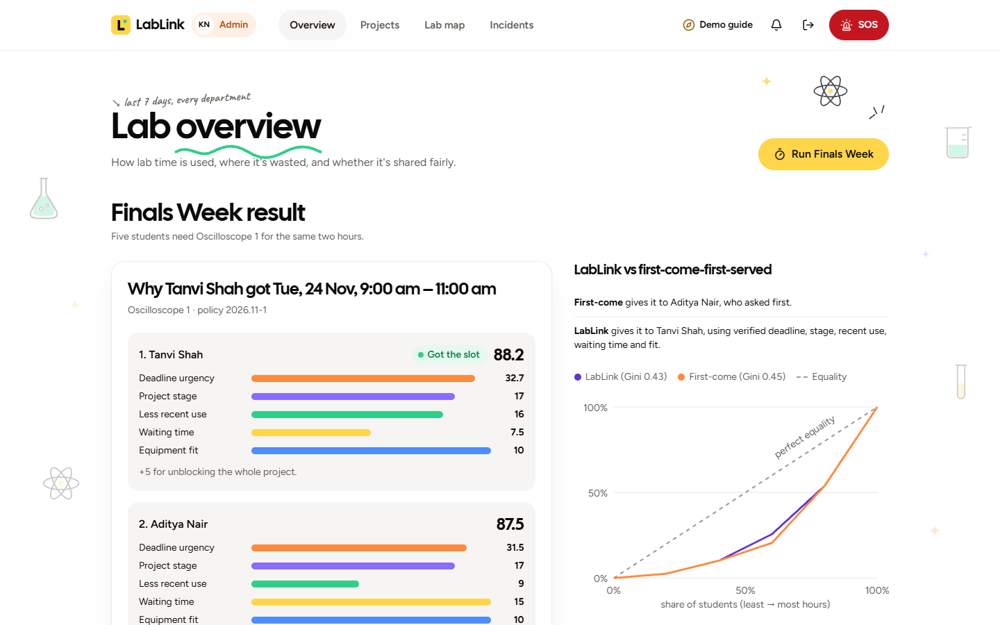](docs/screenshots/finals-week.png) | [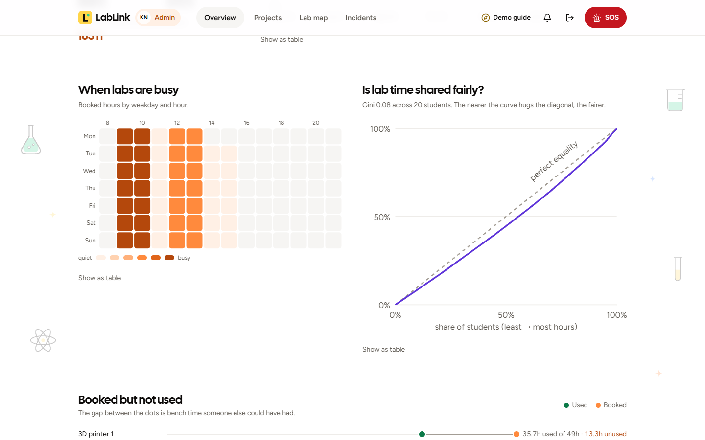](docs/screenshots/analytics.png) |

| Projects on a phone | Bench session on a phone | SOS on a phone |
|---|---|---|
| [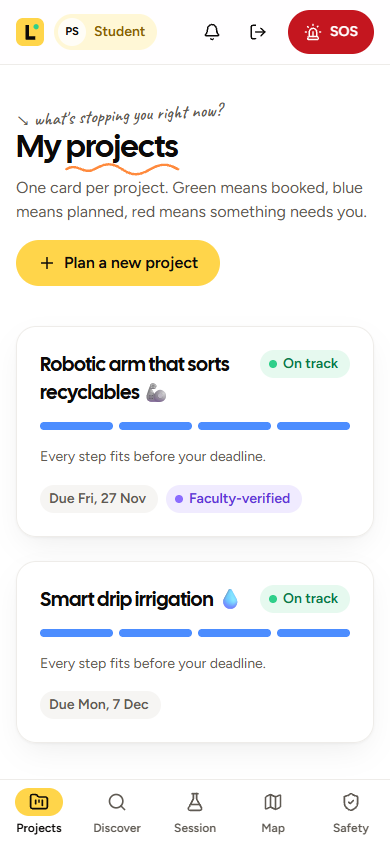](docs/screenshots/phone-projects.png) | [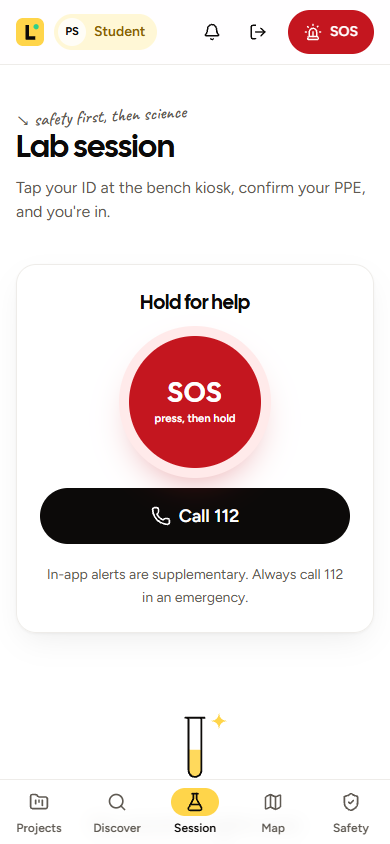](docs/screenshots/phone-session.png) | [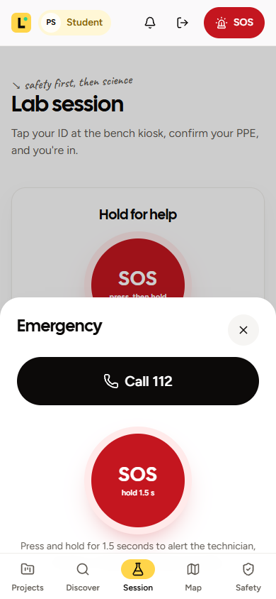](docs/screenshots/sos.png) |

[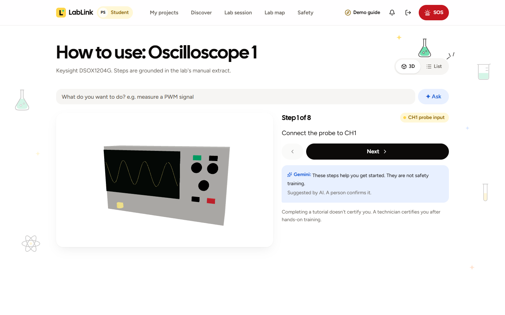](docs/screenshots/explainer.png)

The Finals Week screenshot uses a freshly seeded Firebase emulator. The other screens are from the deployed demo, with a public demo link substituted for the sign-in QR.

---

In a reproducible simulation of **1,000 project requests**, LabLink finished **783 projects on time** compared with **738** for first-come-first-served under the same access and safety rules. Median wait fell from **39 h to 24.1 h**. [Method, results and trade-offs](docs/benchmark-results.md)

## Contents

1. [Screenshots](#1-screenshots)
2. [Chosen vertical and persona](#2-chosen-vertical-and-persona)
3. [The problem, with evidence](#3-the-problem-with-evidence)
4. [What LabLink does](#4-what-lablink-does)
5. [How it works: the smart assistant](#5-how-it-works-the-smart-assistant)
6. [Approach and decision logic](#6-approach-and-decision-logic)
7. [Architecture](#7-architecture)
8. [Key decisions and why](#8-key-decisions-and-why)
9. [What makes it different](#9-what-makes-it-different)
10. [Measured results](#10-measured-results)
11. [Google services used](#11-google-services-used)
12. [How each evaluation area is met](#12-how-each-evaluation-area-is-met)
13. [Try it in 2 minutes](#13-try-it-in-2-minutes)
14. [Run, test and deploy](#14-run-test-and-deploy)
15. [Assumptions](#15-assumptions)
16. [Limitations, stated honestly](#16-limitations-stated-honestly)

---

## 2. Chosen vertical and persona

**Vertical: LabLink — campus laboratory resource sharing (Education).**

> *Create a GenAI-powered campus laboratory resource-sharing platform that helps students discover and access specialised equipment, development kits, and laboratory workstations across departments. The platform should enable equipment discovery, intelligent slot booking, project-based access requests, and faculty approvals while optimising resource utilisation. It should intelligently resolve scheduling conflicts by recommending fair and feasible equipment allocations based on project deadlines, availability, and student requirements.*

LabLink serves four people, and adapts to whoever is holding the phone:

| Persona | What they need | What LabLink gives them |
|---|---|---|
| 🎓 **Student** | "Can I finish my project before the deadline?" | A **Feasibility Passport** per project, one-tap booking of the whole plan, a safe bench session |
| 👩‍🏫 **Faculty** | Approve quickly, fairly, safely | One request per project, an AI copilot summary, deadline and stage verification |
| 🔧 **Technician** | Keep labs running and safe | Live alerts, certification sign-off, equipment status, **Rescue Mode** when something breaks |
| 🏛️ **Head of department** | Use what we own, share fairly | Utilisation, demand heatmap, fairness (Lorenz curve), Opportunity Radar, Finals Week simulator |

Every role signs in with a **college ID card** (scan its QR, tap it via NFC, or a USB reader). There are no passwords, and the header always shows who you are.

## 3. The problem, with evidence

Colleges own expensive instruments that sit idle while students next door can't get access. All figures below come from primary sources ([full evidence and links](docs/research-evidence.md)); each describes its own setting.

| Evidence | Source |
|---|---|
| Large instruments did useful work only **27.6%** of operating time | Song et al., *Frontiers in Education* (2026) |
| One equipment-sharing request took **84.5 hours, across 5 departments and 6 approval steps** | same study |
| **~70%** of users used only basic functions; **15.3%** of machine hours went to setup | same study |
| Faults waited **2.3 days** on average before maintenance began | same study |
| India's I-STEM portal: **88,887** booking requests generated and **44,084** marked executed (as of 31 Mar 2026) | psa.gov.in/i-stem |
| One shared core facility avoided **more than $850,000** in duplicate purchases | Quandt et al., *J Biomol Tech* (2020) |

The problem isn't a missing calendar. It's that **nothing connects a student's project, its deadline, the equipment it needs across departments, the approvals, and safety.**

## 4. What LabLink does

Everything is organised around the **project**, because that's what students are actually trying to finish:

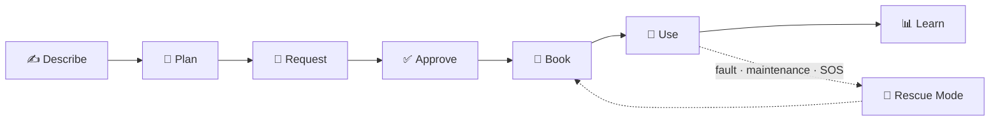

| Step | What happens | Who decides |
|---|---|---|
| **Describe** | Type or speak the project, deadline and stage. | Student |
| **Plan** | Gemini drafts ordered lab steps, parts and physical quantities, mapped onto the real equipment catalogue. **Project X-Ray** explodes the parts in 3D. **Guardian** adds hazards and precautions. | AI drafts, student confirms |
| **Request** | One request covers every resource the project needs. | Student |
| **Approve** | Faculty decide with a PIN. The copilot summarises and flags risks; faculty verify deadline and stage so priority can't be gamed. | Faculty |
| **Book** | The engine places the whole dependency chain before the deadline, then **holds the selected placements in one atomic transaction**. | Deterministic engine |
| **Use** | Tap in at the bench kiosk, confirm PPE, work. Lone-worker check-ins, 3D instrument explainer, fault report, **SOS**. | Student + Guardian |
| **Learn** | Booked vs used, demand heatmap, fairness, **Opportunity Radar** for idle units and over-demand. | Head of department |

The **Feasibility Passport** is each project's home screen and answers one question: *what's stopping this project right now?*

## 5. How it works: the smart assistant

LabLink behaves like an assistant that understands **who you are, what you're building, and what the lab looks like right now**, and acts on that context:

| Context it reads | How it changes what LabLink does |
|---|---|
| **Your role** (from the signed card) | Different home screen, navigation, permissions and actions; staff actions also need a PIN |
| **Your certifications** (and expiry, "supervised only") | Which units you can book, and when (supervised work only when a technician is on shift) |
| **Your project** (steps, deadline, stage, team) | The whole chain is planned in dependency order before your deadline; every team member must be eligible |
| **Today's hours and recent usage** | Fatigue limits (8 h/day with hazardous work, 4 h continuous); lighter users rank higher in fairness |
| **Equipment state** (booked, maintenance, faults, SOS) | Live status everywhere; a fault triggers **Rescue Mode** to re-plan everyone affected |
| **What you said** (plain language or voice) | Gemini turns it into a plan, search filters, hazard checks and explanations, validated before use |
| **Working alone on hazardous equipment** | "Are you OK?" check-ins every 20 minutes; a missed check-in asks a technician to look in |

**Gemini is used for real work in 10 places**, each with a strict output schema and a deterministic fallback:

| AI feature | What it produces | Guardrail |
|---|---|---|
| Project → plan | Ordered steps, durations, equipment classes, parts with physical quantities | Classes must exist in our catalogue; it may decline when unsure |
| Hazard check | Hazards, precautions, PPE | **Can only raise caution** (Guardian monotonic merge) |
| Approval copilot | Summary, risk flags, suggestion | Suggests only; a person decides with a PIN |
| Decision explanation | Plain-language reason for an allocation | Generated from the stored decision record, never decides |
| Equivalence explanation | Why two units are interchangeable | Equivalence itself is decided by spec rules and technicians |
| Instrument explainer | Steps tied to controls on a 3D model | Grounded in the stored manual extract |
| Natural-language search | Filters for equipment discovery | Mapped onto known fields |
| Opportunity Radar | Actions for idle units and over-demand | Generated from computed aggregates |
| Incident report draft | Neutral draft for staff to edit | No blame, no speculation |
| Near-miss clustering | Patterns across anonymous reports | Turns into inspection tasks for humans |

## 6. Approach and decision logic

The core is a **deterministic, explainable engine** in plain TypeScript with no I/O (`src/server/allocation/`). Gemini never decides who gets equipment.

### Layer 1: hard rules (never broken)
Equipment status and maintenance windows, opening hours, supervision, certification (with expiry and level), team eligibility, weekly caps per equipment type, seat capacity with a 15-minute buffer, **no overlapping sessions for one person**, fatigue limits and the lone-worker rule. Every rejection is a sentence a student can act on. → [`hardRules.ts`](src/server/allocation/hardRules.ts)

### Layer 2: feasible project scheduling
A project's steps form a dependency graph (Fabricate → Assemble → Test). Each step is placed at its **earliest feasible slot** on any qualifying unit, including **verified equivalents** in other departments, before the deadline, with **bounded backtracking** when a later step can't fit. Returns *feasible*, *partial* or *infeasible* with the named blocker. → [`scheduler.ts`](src/server/allocation/scheduler.ts)

### Layer 3: fair allocation of contested slots
| Factor | Weight | Why |
|---|---:|---|
| Deadline urgency (**faculty-verified**) | 35 | Urgent work first, but only at full weight once verified |
| Project stage (**faculty-verified**) | 20 | Final builds can't wait like ideas can |
| Less recent usage | 20 | Spreads lab time; heavy users don't crowd others out |
| Waiting time | 15 | Prevents starvation |
| Equipment fit | 10 | The right tool beats a workaround |

Plus a bonus when a slot unblocks a whole project and a capped penalty for no-shows. **Every contested decision stores a record:** candidates, filters, each score, alternatives offered to everyone who missed out, and the policy version. Students can appeal; faculty can run **what-if**; admin overrides need a written reason. A slot that ends after a contender's deadline is filtered out, because it can't help them. → [`fairness.ts`](src/server/allocation/fairness.ts)

### Rescue Mode
When a unit faults, goes into maintenance or triggers an SOS, LabLink finds every affected project (including later dependent steps), keeps unaffected bookings fixed, re-plans the rest on working or equivalent units, and asks faculty only if the recovery changes equipment type. → [`rescue.ts`](src/server/allocation/rescue.ts)

### Guardian: AI may raise caution, only a human may lower it
Staff hazard rules and AI flags are combined with a **monotonic merge**: the level is the maximum, the lists are a union, and a review is required if anyone asks for it. If Gemini fails, the result is exactly the staff rules, so LabLink never becomes less safe. Property tests prove this for thousands of random (including hostile) AI outputs. → [`guardian.ts`](src/server/safety/guardian.ts) · [RESPONSIBLE_AI.md](RESPONSIBLE_AI.md)

### No double-booking, by construction
Each 15-minute seat slot maps to a lock document (`slotLocks/{unit}_{YYYYMMDDHHmm}_{seat}`). Firestore commits every lock in the requested bundle together. The transaction can reclaim expired holds and eligible no-shows on demand. A repeated request with the same idempotency key returns the existing bookings. [Slot-lock implementation](src/server/bookings/slotLocks.ts)

## 7. Architecture

LabLink plans at the **project** level and reserves at the **seat and time-slot** level. The first boundary lets the engine find a dependency chain a student can finish. The second lets Firestore arbitrate concurrent holds. The same allocation functions support previews, contested slots, Rescue Mode and the benchmark.

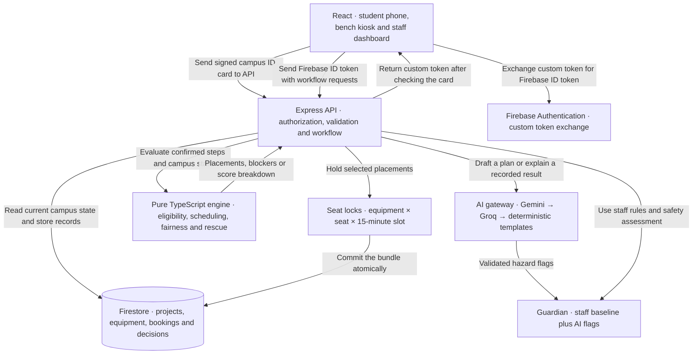

React and the Express API share an origin on Vercel. The same Express app can serve the built SPA in the included Docker image. The API checks that the signed card is active, mints Firebase custom tokens with role claims, and verifies ID tokens with revocation checks. Firestore rules deny direct client writes. [Server entry](src/server/app.ts) · [Card sign-in](src/server/auth/routes.ts) · [API authorization](src/server/middleware/auth.ts) · [Firestore rules](firestore.rules)

### What happens when a student books

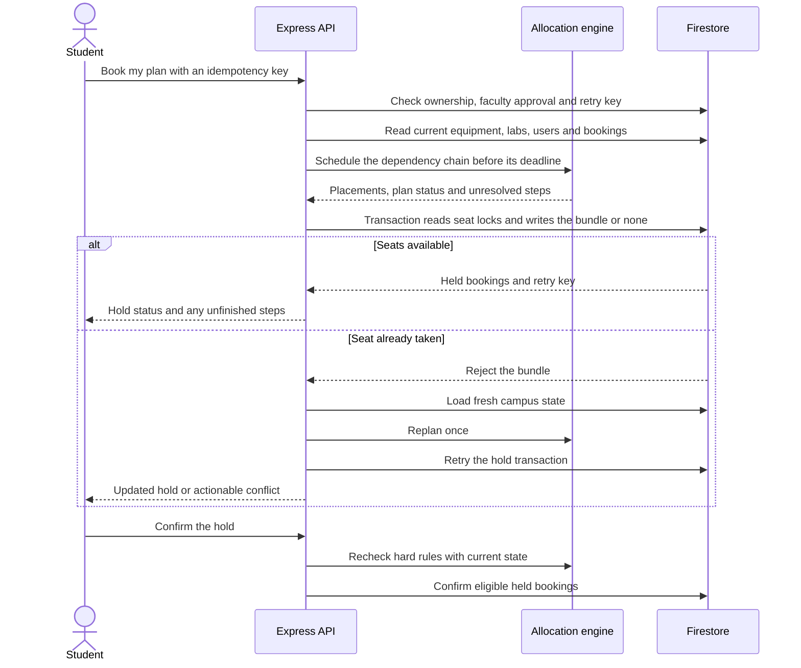

**Atomicity covers every placement included in the hold.** When the scheduler can place only some steps, the response identifies the plan as partial and lists unresolved steps. Each transaction commits bookings, seat locks and the idempotency record together. Retrying the same key returns the original hold. Expired locks can be reclaimed during the transaction. [Booking endpoints](src/server/bookings/routes.ts) · [Lock implementation](src/server/bookings/slotLocks.ts) · [Concurrency and rollback tests](tests/emulator/slotLocks.test.ts)

### Who makes each decision

| Decision | Authority | Where to verify |
|---|---|---|
| What equipment and steps does a project need? | Gemini drafts ordered steps and proposes known equipment classes. Zod validates the answer, and the student confirms the plan. The gateway falls back to Groq or deterministic templates. | [AI features](src/server/ai/uses.ts) · [Gateway tests](tests/ai/client.test.ts) |
| Can each step run safely and before the deadline? | Guardian preserves the staff hazard baseline and can add caution. The engine checks certification, supervision, occupancy, fatigue and opening hours before scheduling the chain. | [Guardian property tests](tests/safety/guardian.test.ts) · [Hard-rule tests](tests/allocation/hardRules.test.ts) · [Scheduler tests](tests/allocation/scheduler.test.ts) |
| Who gets a contested slot? | The deterministic engine filters ineligible contenders and scores eligible ones with a versioned policy. Faculty verification controls the weight of deadline and stage. The decision stores reasons, scores and alternatives. | [Policy](src/server/allocation/policy.ts) · [Fairness implementation](src/server/allocation/fairness.ts) · [Fairness tests](tests/allocation/fairness.test.ts) |
| What happens after equipment fails? | Rescue Mode follows downstream dependencies, keeps unaffected bookings fixed and proposes replacements. Staff retain approval authority for substitutions that require it. | [Rescue implementation](src/server/allocation/rescue.ts) · [Rescue tests](tests/allocation/rescue.test.ts) |

[Module and storage map](docs/architecture.md) · [Responsible AI](RESPONSIBLE_AI.md)

## 8. Key decisions and why

| Decision | Why | Alternative rejected |
|---|---|---|
| **Organise around the project**, not the calendar | The statement asks for project-based requests and deadlines; students think in projects | Separate portals per role: features end up disconnected |
| **Three-layer engine** (rules → chain scheduling → fairness) | A slot score alone can give someone a slot they can't use; layered logic is testable and explainable | A full constraint solver: heavy, opaque, overkill at campus scale |
| **AI drafts and explains; never decides** | Allocation, approval, certification and safety must be accountable to people | Letting the model choose winners: unexplainable and gameable |
| **Monotonic safety merge** | Safety must never get worse because an AI said so | Averaging staff and AI risk: could lower caution |
| **ID cards + Firebase custom tokens** | Labs already issue IDs; no passwords to forget; real auth for judges via demo cards | Email/password login: friction at the bench |
| **One atomic transaction per hold** | If another request takes one of the selected seats, the attempted hold leaves no leftover reservations | Independent writes for each step |
| **Lazy expiry inside transactions** | A booking request can reclaim expired seats as it checks availability | An external sweeper as a dependency for reclaiming a seat |
| **Phone-first UI** | Students carry phones, not laptops, into wet and chemistry labs | Desktop dashboard with a mobile afterthought |
| **Gemini → Groq → template** | Each AI-assisted feature can return a deterministic result when a provider is unavailable | One provider: a rate limit takes the app down |
| **Thin backend + Firestore** | Secrets, signatures and scheduling must live on a trusted server; data stays in Firestore | Client-only app: keys exposed, rules can't schedule |
| **Mumbai region** (Firestore `asia-south1`, Vercel `bom1`) | Users are in India; bookings involve several round trips | US multi-region: slower for every request |

## 9. What makes it different

The benchmark compares LabLink with first-come-first-served (FCFS) under identical safety and access rules. The baseline looks for the nearest eligible slot as requests arrive. LabLink adds dependency-aware scheduling and context-driven priority.

| Situation | What LabLink does | Benefit |
|---|---|---|
| Fabrication fits on Monday, but the test bench is booked past the project deadline | Schedules prerequisite and dependent steps together, checks verified equivalents and names the blocking step | The student sees whether the project can finish before reserving bench time |
| Five students need the same oscilloscope | Filters ineligible contenders and records each score, the policy version and alternatives | Staff can explain the outcome, review an appeal or simulate another allocation |
| A machine fails after students book | Replans affected steps and their dependents around unaffected bookings | Students can see what needs to move and whether recovery needs fresh approval |

In the seeded simulation, LabLink produced **45 more on-time completions** and a **38.2% shorter median wait**, while booking fewer raw hours. Gini was **0.360 for LabLink vs 0.355 for FCFS**, so the measured gains are in deadlines and wait time, with broadly similar distribution of lab hours. [Benchmark method and full results](docs/benchmark-results.md)

## 10. Measured results

`npm run benchmark` runs **first-come-first-served (FCFS)** and **LabLink** on the same seeded campus (100 units, 500 students, 1,000 project requests) **under the same hard rules**. [Full table and caveats.](docs/benchmark-results.md)

| | FCFS | **LabLink** |
|---|---:|---:|
| Projects finished before their deadline | 738 | **783** (+6.1%) |
| Median wait from request to first session | 39 h | **24.1 h** (−38%) |
| Bench hours spent on work that missed its deadline | 549 h | **0 h** |
| Double-bookings | 0 | 0 |

In the benchmark, the LabLink strategy commits complete, deadline-feasible chains, which reduced raw booked hours. Fairness by Gini was similar for the two strategies. The results describe a synthetic campus. The benchmark's invariant tests also caught a fatigue-rule bug when a later session pushed a hazardous day past eight hours. A regression test now covers that case.

## 11. Google services used

| Google service | How LabLink uses it |
|---|---|
| **Gemini API** (`@google/genai`, pinned `gemini-3.5-flash`) | All 10 AI features: structured JSON output, low thinking for latency, zod-validated |
| **Firebase Authentication** | Custom tokens minted from ID-card sign-in, carrying role claims; revocation on lost cards |
| **Cloud Firestore** (Standard, `asia-south1` Mumbai) | All data; **transactions** guarantee no double-booking; least-privilege security rules deny every client write |
| **Firebase Admin SDK** | Server-side Firestore and Auth (token minting, `verifyIdToken` with revocation check) |
| **Firebase Local Emulator Suite** | Local development and 25 integration tests (API flow, concurrency, security rules) |
| **Firebase CLI** | Deploys Firestore rules and indexes |
| **Google Cloud Run** (ready) | Multi-stage `Dockerfile`; `gcloud run deploy --source .` deploys the same app |

The live demo runs in the Mumbai Vercel region. The Dockerfile provides a Cloud Run deployment path.

## 12. How each evaluation area is met

| Area | Evidence |
|---|---|
| **Problem statement alignment** | All five capabilities are modules and screens: discovery, intelligent slot booking, project-based requests, faculty approvals, fair and feasible conflict resolution driven by deadlines, availability and requirements. Measured against FCFS. |
| **Code quality** | Strict TypeScript end to end; modules named after the requirements; shared zod schemas ([`domain.ts`](src/shared/domain.ts)); a pure engine with no I/O; every module has a doc comment explaining why; ESLint + Prettier; small focused files. |
| **Security** | HMAC-signed card tokens with constant-time verification and revocation; Firebase custom tokens with server-side role claims and `checkRevoked`; bcrypt staff PINs with 15-minute lockout after 5 tries; zod validation on every input; helmet CSP and security headers; rate limits; Firestore rules that deny all client writes ([tested](tests/emulator/rules.test.ts)); AI output treated as untrusted with a prompt-injection guard; secrets only in environment variables (enforced by `npm run presubmit`). |
| **Efficiency** | Code-split routes; three.js loads only when a 3D view opens; indexed booking lookups in the engine; AI caching and in-flight de-duplication; AI-heavy panels (copilot, equivalence) load per item so pages render instantly; lazy slot expiry (no cron); Mumbai region; phones default to light list views. |
| **Testing** | **107 tests**: 82 unit/property/UI/accessibility tests (Guardian property tests with fast-check, engine rules, scheduler, fairness, rescue, card tokens, PIN lockout, AI fallbacks, axe-core) + 25 on the Firebase emulators (**20 simultaneous holds → exactly 1 wins**, capacity, atomic rollback, idempotency, the full API flow, security rules) + benchmark invariants. CI runs everything with AI disabled so every fallback is exercised. |
| **Accessibility** | Phone-first layout and 44 px targets; semantic HTML and a skip link; visible focus; status always shown as colour **and** word; `aria-live` for AI output and alerts; every 3D view and chart has a list or table alternative; reduced motion respected; voice input; typed and USB-reader alternatives to camera scanning; opt-in evacuation plans; Call 112 always the largest action. |

## 13. Try it in 2 minutes

1. Open **[lablink-campus.vercel.app](https://lablink-campus.vercel.app)** → **Try the live demo**.
2. **Student (Priya):** open *Robotic arm* → see the Feasibility Passport → **Book my plan** → **Confirm**. Try **SOS** (hold 1.5 s; the demo sends no real alert).
3. **Admin (PIN 9999):** **Run Finals Week**: five students, one oscilloscope, a fair, explained decision, with LabLink vs first-come fairness compared.
4. **Technician (PIN 1357):** open a booked unit → **Change status → out of service**: Rescue Mode re-plans affected projects.
5. **Faculty (PIN 2468):** approve a request with the copilot's summary.

The compass icon in the header opens a **Demo guide** with these steps.

## 14. Run, test and deploy

**Local** (Node 22+, Java 21 for the emulators):

```bash
npm ci
cp .env.example .env          # set CARD_HMAC_SECRET; GEMINI_API_KEY is optional
npm run emulators             # terminal 1
FIRESTORE_EMULATOR_HOST=127.0.0.1:8081 npm run seed
FIRESTORE_EMULATOR_HOST=127.0.0.1:8081 FIREBASE_AUTH_EMULATOR_HOST=127.0.0.1:9099 npm run dev
```

Without an AI key, every AI feature uses its deterministic fallback, so the whole app still works.

**Tests and checks:**

```bash
npm test               # 82 unit, property, UI and accessibility tests
npm run test:emulator  # 25 API, concurrency and security-rules tests
npm run benchmark      # writes docs/benchmark-results.md
npm run presubmit      # one branch, < 9 MB, no secrets tracked
```

**Deploy:** Vercel (`vercel.json`, API bundled by `scripts/build-api.mjs`) or Cloud Run (`gcloud run deploy --source . --region asia-south1`). Environment variables are listed in [`.env.example`](.env.example).

## 15. Assumptions

- Each student and staff member has a college ID card that can carry a signed token (QR printed on it, or written to an NFC tag).
- Departments share a common equipment catalogue; technicians verify which units are interchangeable.
- One approval step (faculty) per department; the data model supports longer chains.
- Campus time is Asia/Kolkata; labs open 08:00–20:00 (some until 22:00) and are staffed 09:00–18:00.
- Slots are 15 minutes with a 15-minute buffer; holds expire after 30 minutes; no-shows are released after 15 minutes.
- Fairness weights (35/20/20/15/10) are a sensible default, versioned so a college can tune them.
- The demo institution is synthetic and isolated; the demo SOS never alerts real people.

## 16. Limitations, stated honestly

- **QR ID cards are demo-grade.** A signed QR can't be forged but can be photographed. A real rollout would use secure NFC (challenge-response) or the college's SSO; staff PINs and kiosk time limits reduce the risk meanwhile.
- **SOS is supplementary.** In-app alerts reach signed-in staff; delivery isn't guaranteed. Call 112 is always the largest action, and SOS instructions are written by staff, never by AI.
- **Project X-Ray is illustrative**, not a physics simulation, and says so on screen.
- **The benchmark is a simulation** on synthetic data. Research figures describe the real problem; benchmark figures describe LabLink. We never mix them.
- Rate limits are per server instance; consumables and travel time between buildings are out of scope.

---

<div align="center">

Made for PromptWars 2026 · [Responsible AI](RESPONSIBLE_AI.md) · [Architecture](docs/architecture.md) · [Benchmark](docs/benchmark-results.md) · [Research](docs/research-evidence.md) · MIT licence

</div>
