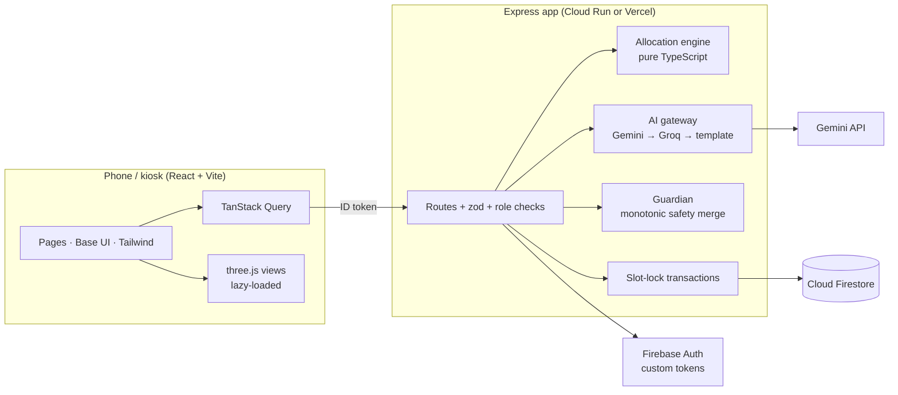

# LabLink

**Don't just book equipment. Make your project possible.**

LabLink is a GenAI campus lab platform. A student describes a project in plain words; LabLink turns it into a **feasible, fair, safe plan** across every department's labs, gets it approved, books every step atomically, keeps the student safe at the bench, and **re-plans automatically** when an instrument breaks.

> **Live app:** _link added at submission_ · **Try it in 30 seconds:** open the app, tap any demo ID card, then open **Demo guide** (compass icon) for a four-step tour.

| Demo card | Role | Staff PIN |
|---|---|---|
| Priya Sharma | Student | none |
| Dr. Anil Rao | Faculty | 2468 |
| Meera Iyer | Technician | 1357 |
| Prof. Kavya Nair | Admin / HoD | 9999 |

Demo cards are real signed card tokens that go through the same server path as a scanned college ID. The demo institution is isolated, and SOS in the demo sends no real alert.

---

## The problem

Colleges own expensive instruments that sit idle while students in the next building can't get access. The numbers below come from primary sources ([full evidence and sources](docs/research-evidence.md)); each describes its own setting, not all universities.

- Large instruments did useful work only **27.6%** of their operating time in one university study, and one equipment-sharing request took **84.5 hours across 5 departments and 6 approval steps** (Song et al., *Frontiers in Education*, 2026).
- **~70%** of users used only basic functions, and **15.3%** of machine hours went to setup: students lack guidance (same study).
- Faults took **2.3 days** on average before maintenance started (same study).
- As of 31 March 2026, India's I-STEM portal reported **88,887** facility booking requests generated and **44,084** marked executed (psa.gov.in/i-stem).
- Sharing works when it's organised: one shared core facility avoided **more than $850,000** in duplicate purchases (Quandt et al., *J Biomol Tech*, 2020), and coordinated digital management cut waiting from **3.2 to 0.5 days** in a single-institution case study (Song et al.).

## What LabLink does

Everything is organised around the **project**, because that is what students are actually trying to finish:

```
DESCRIBE ─► PLAN ─► REQUEST ─► APPROVE ─► BOOK ─► USE ─► LEARN
                                  ▲                 │
                                  └── RESCUE MODE ◄─┘  (fault · maintenance · SOS)
```

| Step | What happens | Where |
|---|---|---|
| **Describe** | Type or speak the project, deadline and stage. | `src/web/features/projects/NewProject.tsx` |
| **Plan** | Gemini drafts ordered lab steps, parts and physical quantities, mapped onto the real equipment catalogue. **Project X-Ray** explodes it in 3D. Guardian adds hazards. The student edits and confirms. | `src/server/ai/uses.ts`, `src/web/three/Xray.tsx`, `src/server/safety/guardian.ts` |
| **Request** | One request per project covers every resource. | `src/server/projects/routes.ts` |
| **Approve** | Faculty decide with a PIN; an AI copilot summarises and flags risks but never decides. Faculty verify deadline and stage so nobody can game priority. | `src/server/approvals/routes.ts` |
| **Book** | A three-layer engine places the whole dependency chain, then holds every slot in **one atomic transaction**. | `src/server/allocation/`, `src/server/bookings/slotLocks.ts` |
| **Use** | Tap your ID at the bench kiosk, confirm PPE, work. Lone-worker check-ins, instrument explainer, fault report, **SOS**. | `src/web/features/safety/Session.tsx` |
| **Learn** | Booked vs used, demand heatmap, fairness (Lorenz curve), and **Opportunity Radar** for idle units and over-demand. | `src/server/utilisation/routes.ts`, `src/web/features/admin/` |

The **Feasibility Passport** is each project's home screen and answers one question: *what's stopping this project right now?*

### The engine (deterministic, explainable, tested)

1. **Hard rules** that are never broken: equipment status and maintenance, opening hours, supervision, certification (with expiry and "supervised only"), team eligibility, weekly caps, seat capacity with a 15-minute buffer, no overlapping sessions, and Guardian's fatigue (8 h/day with hazardous work, 4 h continuous) and lone-worker rules. Every rejection is a sentence a student can act on. [`hardRules.ts`](src/server/allocation/hardRules.ts)
2. **Feasible project scheduling:** tasks form a DAG; each is placed at its earliest feasible slot on any qualifying or verified-equivalent unit before the deadline, with bounded backtracking. Returns *feasible*, *partial* or *infeasible* with the blocking reason. [`scheduler.ts`](src/server/allocation/scheduler.ts)
3. **Fair allocation** of contested slots: verified deadline (35), stage (20), less recent use (20), waiting time (15), equipment fit (10), plus a no-show penalty. Every decision stores a record (candidates, scores, filters, alternatives, policy version), which students can appeal and faculty can test with **what-if**. [`fairness.ts`](src/server/allocation/fairness.ts)

**Rescue Mode** re-plans every affected project when a unit fails, keeps unaffected bookings fixed, and asks faculty only when the recovery uses different equipment. [`rescue.ts`](src/server/allocation/rescue.ts)

Double-booking is impossible by construction: each 15-minute seat slot is a lock document, and a project's whole bundle is acquired in one Firestore transaction. Expired holds and no-shows are released lazily inside the transaction, so correctness never depends on a cron job. Requests are idempotent.

## Measured results

`npm run benchmark` runs **first-come-first-served (FCFS)** and **LabLink** on the same seeded campus (100 units, 500 students, 1,000 project requests) **under the same hard rules**. Full table and caveats: [docs/benchmark-results.md](docs/benchmark-results.md).

| | FCFS | LabLink |
|---|---:|---:|
| Projects finished before their deadline | 738 | **783** (+6.1%) |
| Median wait from request to first session | 39 h | **24.1 h** (−38%) |
| Bench hours spent on work that missed its deadline | 549 h | **0 h** |
| Double-bookings | 0 | 0 |

LabLink books slightly fewer raw hours, because it won't hold bench time for chains that can't finish in time; fairness (Gini) is about the same. This is a simulation: it shows what the algorithm does, not what a real campus will see.

## Why it's different

| | Spreadsheets / email | FCFS booking tools | Core-facility software (iLab-style) | **LabLink** |
|---|:-:|:-:|:-:|:-:|
| Book a slot | ✓ | ✓ | ✓ | ✓ |
| Approvals and training records | partly | | ✓ | ✓ |
| Plans a **whole project's chain** before the deadline | | | | ✓ |
| Fair priority with an **explainable record** and appeal | | | | ✓ |
| **Rescue Mode** when equipment fails | | | | ✓ |
| AI that can only **raise** safety caution | | | | ✓ |
| Cross-department sharing with verified equivalents | | | partly | ✓ |

## Sustainability and who it helps

- **Fewer duplicate purchases.** Opportunity Radar shows idle units in one department and over-demand in another, so departments share before they buy.
- **Less wasted bench time.** No-shows are released after 15 minutes; booked-vs-used is visible per unit.
- **Students** get a plan that works and a clear reason when it doesn't. **Faculty** review one request per project, with a summary. **Technicians** see faults, check-ins and safety patterns. **Heads of department** see utilisation and fairness.
- **Accessibility:** phone-first design (students carry phones, not laptops, in wet labs), voice input, accessible-bench filter, opt-in evacuation plans, full keyboard use and screen-reader support.

## How each judging criterion is covered

| Criterion | Evidence |
|---|---|
| **Code quality** | Strict TypeScript end to end; modules named after the requirements (`discovery`, `projects`, `approvals`, `bookings`, `allocation`, `safety`, `utilisation`); shared zod schemas ([`src/shared/domain.ts`](src/shared/domain.ts)); pure engine with no I/O; ESLint + Prettier; JSDoc on every module. |
| **Security** | Signed HMAC ID-card tokens with constant-time verification and revocation ([`cardToken.ts`](src/server/auth/cardToken.ts)); Firebase custom tokens with server-side role claims, checked with `checkRevoked`; bcrypt staff PINs with lockout ([`pin.ts`](src/server/auth/pin.ts)); zod validation on every input; helmet CSP, rate limits; least-privilege Firestore rules that deny all client writes ([`firestore.rules`](firestore.rules), tested); AI output treated as untrusted and prompt-injection-guarded; no secrets in the repo (enforced by `npm run presubmit`). |
| **Efficiency** | Code-split routes; three.js loads only when a 3D view opens; indexed booking lookups in the engine; AI caching and in-flight de-duplication; lazy slot expiry (no cron); `/health` touches nothing; phones default to light list views. |
| **Testing** | 82 unit/property/UI tests + 25 emulator tests: Guardian property tests (fast-check: AI can never lower safety; a missed check-in never becomes an SOS), engine rules, scheduler, fairness, rescue, card tokens, PIN lockout, AI fallbacks, **20 concurrent holds → exactly 1 wins**, atomic rollback, idempotency, full API flow, Firestore rules, axe-core accessibility, and benchmark invariants (zero conflicts, zero rule breaks, deterministic). CI runs everything with AI disabled so every fallback is exercised. |
| **Accessibility** | Semantic HTML, skip link, visible focus ring, 44 px targets, status always as colour + word, `aria-live` for AI and alerts, every 3D view and chart has a list or table alternative, reduced motion respected, voice input, typed and USB-reader alternatives to camera scanning, phone-first layout. |
| **Problem alignment** | Discovery, intelligent slot booking, project-based requests, faculty approvals and fair, feasible conflict resolution are each a module and a screen; deadlines, availability and requirements drive the engine; measured against FCFS. |

## Google technology

- **Gemini** (`@google/genai`, pinned `gemini-3.5-flash`) for project planning, X-Ray parts, hazard checks, the approval copilot, decision explanations, the instrument explainer, Opportunity Radar, incident drafts, near-miss clustering and search. Structured output, validated with zod, with a Groq fallback and a deterministic template for every use.
- **Firebase Auth** (custom tokens from ID cards) and **Cloud Firestore** (transactions for slot locks).
- **Cloud Run** via the included `Dockerfile`; the same app also deploys to Vercel.

## Architecture



More detail: [docs/architecture.md](docs/architecture.md) · Safety and AI principles: [RESPONSIBLE_AI.md](RESPONSIBLE_AI.md)

## Run it locally

Requirements: Node 22+, Java 21 (for the Firebase emulators).

```bash
npm ci
cp .env.example .env          # add GEMINI_API_KEY (optional), set CARD_HMAC_SECRET
npm run emulators             # terminal 1: Auth + Firestore emulators
FIRESTORE_EMULATOR_HOST=127.0.0.1:8081 npm run seed      # terminal 2
FIRESTORE_EMULATOR_HOST=127.0.0.1:8081 FIREBASE_AUTH_EMULATOR_HOST=127.0.0.1:9099 npm run dev
# open http://localhost:5173 and tap a demo card
```

Without a Gemini key every AI feature uses its deterministic fallback, so the whole app still works.

```bash
npm test               # 82 unit, property, UI and accessibility tests
npm run test:emulator  # concurrency, API flow and security rules on the emulators
npm run benchmark      # writes docs/benchmark-results.md
npm run presubmit      # one branch, < 9 MB, no secrets
```

## Deploy

- **Cloud Run:** `gcloud run deploy lablink --source . --region asia-south1` (secrets via Secret Manager: `CARD_HMAC_SECRET`, `GEMINI_API_KEY`).
- **Vercel:** import the repo; set `CARD_HMAC_SECRET`, `GEMINI_API_KEY`, `GROQ_API_KEY`, `FIREBASE_PROJECT_ID`, `FIREBASE_SERVICE_ACCOUNT` (service-account JSON) and the `VITE_FIREBASE_*` web config. `vercel.json` is included.

Then run `npm run seed -- --production` once with the service account to load the demo institution.

## Honest limitations

- **QR ID cards are demo-grade.** A signed QR can't be forged, but it can be photographed and reused. A real deployment would use secure NFC cards (challenge-response) or the college's SSO; the staff PIN and kiosk time limits reduce the risk meanwhile.
- **SOS is supplementary.** In-app alerts reach people who are signed in; delivery isn't guaranteed. Call 112 is always the largest action, and SOS instructions are pre-written by staff, never generated by AI.
- **X-Ray is illustrative**, not a physics simulation, and says so on screen.
- **The benchmark is a simulation** on synthetic data. Research figures describe the real problem; benchmark figures describe LabLink. We never mix them.
- Rate limits are per server instance; consumables and travel time between buildings are out of scope.
